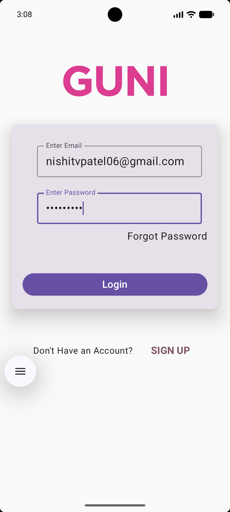
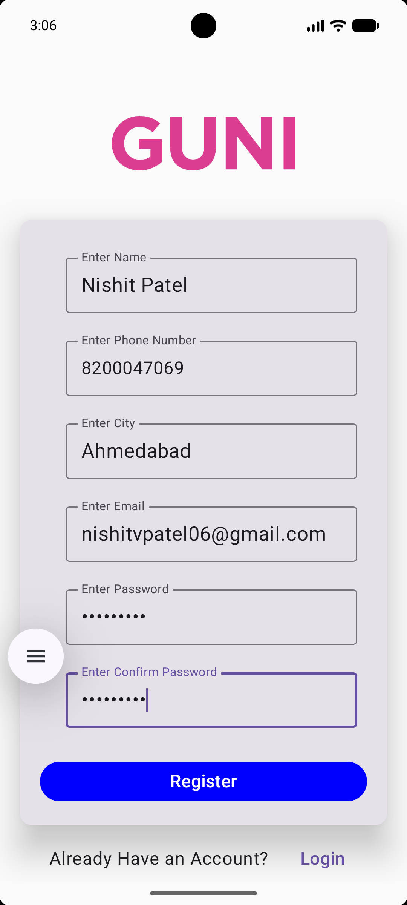

# Mobile Application Development (MAD) - Jetpack Compose

## 📌 Student & Practical Details

| Information | Details |
| :--- | :--- |
| **Student Name** | **Nishit Patel** |
| **Enrollment No.** | **24012011115** |
| **Course** | Mobile Application Development (MAD) |
| **Aim** | Create an Android Application that includes Login and Registration screens using Jetpack Compose. |

---

## 📖 Overview

This Android application demonstrates an end-to-end authentication UI flow built completely using **Jetpack Compose** and **Material Design 3**. It illustrates modern declarative UI design, navigation between authentication screens using **Navigation Compose**, and modular, reusable input field components with input validation and transformations.

---

## 📱 Screenshots

| Login Screen | Registration Screen |
| :---: | :---: |
|  |  |

---

## 🔬 Technical Approach & Architecture

The application is engineered following modern Android development best practices and Jetpack Compose design patterns:

### 1. Declarative UI Paradigm vs. Traditional XML
* Unlike the legacy Android View system (XML layouts + `findViewById` / ViewBinding), the entire interface is built using **declarative Composable functions**.
* UI elements are directly bound to state; whenever the state changes, Compose intelligently triggers **recomposition** only for the affected components, maximizing performance and eliminating boilerplate code.

### 2. State Management & Unidirectional Data Flow (UDF)
* **Local State Holding**: UI states for form inputs (such as `email`, `password`, `fullName`, `phone`, `city`, and `confirmPassword`) are declared using `remember { mutableStateOf("") }`.
* **State Hoisting**: Input components follow the state hoisting pattern where the child composable (`FormField`) receives the current value and emits changes back to the caller via an `onTextChange: (String) -> Unit` callback.

### 3. Modular & Reusable Component Design (`FormField.kt`)
To avoid repeating boilerplate `OutlinedTextField` code across multiple screens, a centralized, flexible field component was designed:
* **Password Masking**: Utilizes `visualTransformation = PasswordVisualTransformation()` when `isPasswordField = true`, concealing sensitive credentials with bullet characters.
* **Keyboard Customization**: Dynamically applies `KeyboardOptions(keyboardType = KeyboardType.Password / KeyboardType.Number / KeyboardType.Text)` to present the most convenient soft keyboard to the user.
* **Input Filtering**: In `NumericOutlinedTextField`, a strict character check `newText.all { it.isDigit() }` is applied inside `onValueChange` to guarantee only numerical inputs are accepted for phone numbers.

### 4. Single-Activity Navigation Architecture
* Built on a Single-Activity architecture (`MainActivity`) driven by **Jetpack Navigation Compose**.
* A `NavHost` is configured with a `rememberNavController()`, defining discrete string-based routes (`"login"` and `"register"`).
* Screen composables receive navigation actions to decouple destination routing from individual widget structures.

### 5. Layout, Scrolling & Keyboard Handling
* **Edge-to-Edge Experience**: `enableEdgeToEdge()` is enabled in `MainActivity`, with `Modifier.safeDrawingPadding()` applied to respect status bars, navigation bars, and display cutouts.
* **Scroll Resilience**: Both `LoginScreen` and `RegisterScreen` wrap content in `Modifier.verticalScroll(rememberScrollState())` paired with `adjustResize` soft input mode, ensuring all form fields and submit buttons remain fully accessible and visible when the on-screen keyboard appears.
* **Material 3 Depth**: Uses `Card` with `CardDefaults.cardElevation(defaultElevation = 20.dp)` and rounded shapes for visual depth and clean card-based grouping.

### 6. Design System & Theming
* Configured using **Material 3** (`MaterialTheme`) with a defined `LightColorScheme`.
* Centralized color definitions (`Color.kt`) and typography definitions (`Type.kt`) ensure styling consistency across the entire app.

---

## ✨ Features

- **Login Screen**:
  - Ganpat University branding header.
  - Email and password input with security masking.
  - "Forgot Password" action.
  - "Login" trigger with visual feedback.
  - Navigation button switching to the Register screen.
- **Registration Screen**:
  - Complete sign-up form: Name, Phone Number, City, Email, Password, and Confirm Password.
  - Numeric-only validation on the phone number field.
  - Navigation button toggling back to Login.
- **Reusable Input Components**:
  - Generic `FormField` for standard text and password inputs.
  - Dedicated `NumericOutlinedTextField` for telephone/numeric inputs.

---

## 🛠️ Tech Stack & Dependencies

- **Language**: Kotlin `2.2.10`
- **UI Framework**: Jetpack Compose (`androidx.compose.ui`, `androidx.compose.material3`)
- **BOM**: Compose Bill of Materials `2026.02.01`
- **Navigation**: Navigation Compose `2.9.8`
- **Minimum SDK**: Android 7.0 (API 24)
- **Target SDK**: Android 16 (API 37)
- **Build System**: Gradle Kotlin DSL (`build.gradle.kts`) with Version Catalog (`libs.versions.toml`)

---

---

## 🚀 How to Run the Project

1. **Open Project in Android Studio**:
   - Launch **Android Studio** (Ladybug or newer).
   - Select **Open** and choose the `24012011115_MAD_Jetpackcompose` folder.

2. **Sync Project with Gradle Files**:
   - Wait for Android Studio to download dependencies and finish indexing.

3. **Deploy to Device / Emulator**:
   - Select an Android Virtual Device (AVD running API 24+) or connect a physical device with USB Debugging enabled.
   - Press **Run 'app'** (`Shift + F10`) to compile and launch.

---

## 🎯 Learning Outcomes

1. Gained hands-on experience developing an Android app using **Jetpack Compose** declarative architecture.
2. Understood state hoisting and UI re-composition using `remember` and `mutableStateOf`.
3. Implemented single-activity screen navigation with **Navigation Compose**.
4. Applied **Material 3** theming, cards, elevations, and dynamic keyboard input transformations.
